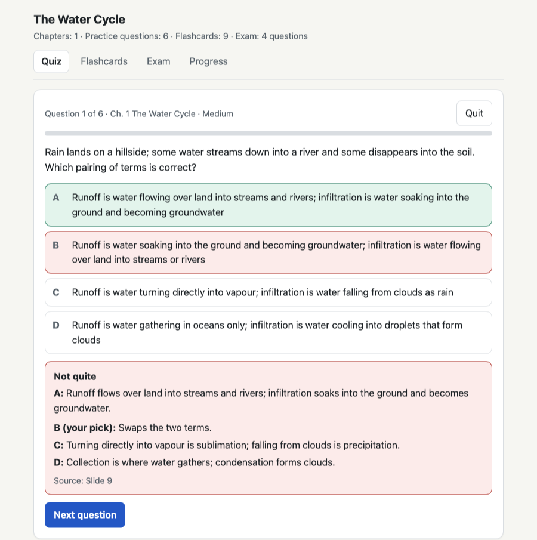
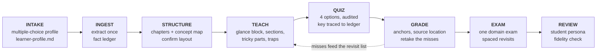
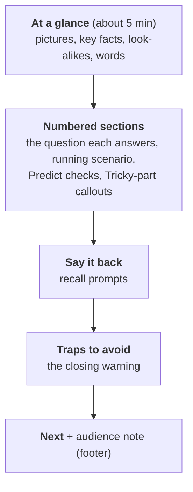
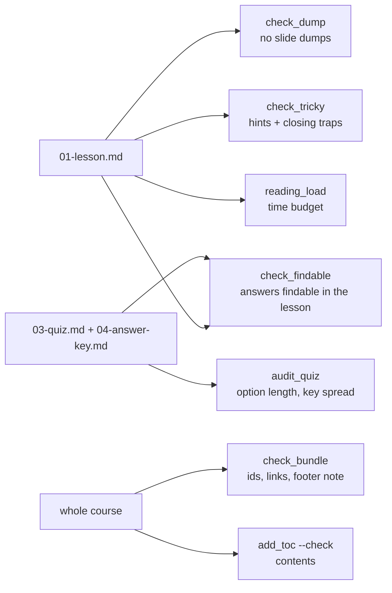

# study-guide-tutor

**Give an AI coding agent your slides, lecture notes or PDFs and get a tutoring course back: lessons that teach instead of re-formatting the slides, quizzes that cannot be passed by picking the longest option, and a revisit plan for what you missed.**



*The interactive player that the skill builds for every course: click an answer and see at once why each wrong option is wrong, with its source. Shown on the invented sample course in `tests/fixtures/`.*

[](https://github.com/bassem-elsodany/study-guide-tutor-skill/actions/workflows/ci.yml) [](LICENSE) [](https://github.com/bassem-elsodany/study-guide-tutor-skill/releases)

One skill, two agents, six slash commands, seventeen scripts, an interactive study player and a set of quality gates that make an agent *ask about the learner first*, *read all of the material before teaching*, *check every fact against a ledger*, *write lessons a teacher would write*, *warn where students get confused*, *audit every quiz*, and *grade with a memory anchor for every miss*. Built for [Claude Code](https://claude.com/claude-code); the skill is plain Markdown plus standard-library Python, so other agents can use it too.

*Topics: education, study-guide, exam-preparation, quiz, flashcards, active-recall, spaced-repetition, agent-skills, claude-code.*



*Each stage has a reference file and, where it can be checked mechanically, a script that fails the build.*

> **New here?** Install it (next section), then read [`skills/study-guide-tutor/SKILL.md`](skills/study-guide-tutor/SKILL.md): the decision guide with the whole loop, the study modes and the file layout. [`AGENTS.md`](AGENTS.md) is the short operating manual for coding agents.

---

## Quick start (about two minutes)

**1. Install**: in Claude Code:

```
/plugin marketplace add bassem-elsodany/study-guide-tutor-skill
/plugin install study-guide-tutor@study-guide-tutor
```
(Replace `bassem-elsodany/study-guide-tutor-skill` with the repository you cloned from.)

**2. Reload and check**: run `/reload-plugins` (or start a new session), then `/plugin` → *Installed*: `study-guide-tutor` should be listed and enabled. Type `/study` and the commands appear (full names look like `/study-guide-tutor:study`).

**3. Try it**: put your slides, notes or a PDF in a folder and ask:

```text
> Teach me this material.                      → intake questions first, then ingest, chapter list, lesson 1
> Quiz me on chapter 3.                        → audited questions, graded with a memory anchor per miss
> I only have an hour before the exam.         → cram mode: recap from the fact ledger, flashcards, one quiz
> Quiz me on what I missed.                    → weak-area loop with fresh-variant questions
```

**4. Or use the commands:**

```text
/study-guide-tutor:study ./lecture-notes.pdf      start a course from your material
/study-guide-tutor:study-quiz 3                   quiz chapter 3
/study-guide-tutor:study-quiz 3B 1D 2A            grade your answers
/study-guide-tutor:study-check ./my-course        run every quality gate on a generated course
```

---

## Installation

### Requirements

| Needed | Check | Used for |
|---|---|---|
| Claude Code (recent; plugin support) | `claude --version` | the plugin: skill, agents, commands |
| `python3` 3.9 or newer (developed on 3.13; CI runs 3.11) | `python3 --version` | every script (standard library only) |
| `git` | `git --version` | installing from a repository |
| *Optional:* `pdftotext` (poppler) | `pdftotext -v` | extracting text from PDFs (`brew install poppler` / `apt install poppler-utils`); without it the scripts fall back to `pypdf`, `PyPDF2` or PyMuPDF if installed |
| *Optional:* `mmdc` (Mermaid CLI) | `mmdc --version` | validating the diagrams in lessons (`npm i -g @mermaid-js/mermaid-cli`); without it diagrams are written but not validated |

Tested on macOS (Apple silicon) with Claude Code. Linux is expected to work. Windows is untested: use WSL. Image-only slides cannot be read by `pdftotext`: the skill transcribes them once and caches the result.

### Claude Code

<details open>
<summary><b>From a hosted repository (recommended)</b></summary>

Inside a Claude Code session:

```
/plugin marketplace add bassem-elsodany/study-guide-tutor-skill
/plugin install study-guide-tutor@study-guide-tutor
/reload-plugins
```

or from your shell:

```bash
claude plugin marketplace add bassem-elsodany/study-guide-tutor-skill
claude plugin install study-guide-tutor@study-guide-tutor            # --scope user (default) | project | local
```

`bassem-elsodany/study-guide-tutor-skill` can also be a full git URL (`https://github.com/bassem-elsodany/study-guide-tutor-skill.git`, GitLab, a self-hosted host) or an SSH address.

**`Permission denied (publickey)`?** The marketplace is cloned with git. Either add an SSH key to your host, or use the HTTPS URL:

```
/plugin marketplace add https://github.com/bassem-elsodany/study-guide-tutor-skill.git
```

</details>

<details>
<summary><b>From a local clone (also the way to try changes)</b></summary>

```bash
git clone https://github.com/bassem-elsodany/study-guide-tutor-skill.git ~/src/study-guide-tutor-skill

# A) install it (persistent)
claude plugin marketplace add ~/src/study-guide-tutor-skill
claude plugin install study-guide-tutor@study-guide-tutor

# B) or load it for ONE session only, nothing installed
claude --plugin-dir ~/src/study-guide-tutor-skill
```

After editing the clone, `/reload-plugins` picks up skill and command changes in a running session.

</details>

<details>
<summary><b>Just the skill, without the plugin system</b></summary>

Copy (or symlink) the folder `skills/study-guide-tutor/` to `~/.claude/skills/study-guide-tutor/` (all projects) or `<project>/.claude/skills/study-guide-tutor/` (one project). You get the skill and its scripts; the agents and slash commands come with the plugin.

</details>

<details>
<summary><b>For a whole team (project scope)</b></summary>

```bash
claude plugin marketplace add bassem-elsodany/study-guide-tutor-skill --scope project
claude plugin install study-guide-tutor@study-guide-tutor --scope project
git add .claude/settings.json && git commit -m "chore: enable study-guide-tutor for the team"
```

Settings are shared through git, but each teammate still adds the marketplace and runs the install command once in their own clone.

</details>

### Other agents (skill only: no agents or slash commands)

Codex, Cursor, Gemini CLI, GitHub Copilot, OpenCode, Windsurf/Devin and Kiro discover skills as folders containing `SKILL.md`, most of them in a shared `.agents/skills/` location (Kiro: `.kiro/skills/`).

```bash
git clone https://github.com/bassem-elsodany/study-guide-tutor-skill.git ~/src/study-guide-tutor-skill
cd /path/to/your/study/folder
~/src/study-guide-tutor-skill/scripts/install-agents.sh --agents-md        # ./.agents/skills + a managed block in ./AGENTS.md
#   --scope user --agents-md ~/AGENTS.md   all your projects   ·   --kiro   also .kiro/skills
#   --mode copy   self-contained copy       ·   --dry-run  preview   ·   --uninstall  remove only what it created
```

Restart the agent so it rediscovers the skill. **What was tested:** the installer itself (link and copy modes, project and user scope, uninstall) on macOS in throw-away directories. **What was not:** the agents themselves. Details: [docs/other-agents.md](docs/other-agents.md).

### Troubleshooting

| Symptom | Fix |
|---|---|
| `/study` says unknown command | commands are namespaced: `/study-guide-tutor:study`; type `/study` and pick from the menu; run `/reload-plugins` after installing |
| The skill never triggers | `/plugin` → *Errors* tab; make sure the plugin is enabled in this project's scope; say it explicitly: "use the study-guide-tutor skill to teach me this PDF" |
| Text from a PDF is empty or garbled | install `pdftotext` (poppler); for scanned or image-only slides the skill transcribes each slide once (the cache is `<name>.slides.txt` beside the original) |
| A script path shows a literal `${CLAUDE_SKILL_DIR}` | you installed the skill outside Claude Code: read it as the folder that contains `SKILL.md` |
| `check_findable.py` flags an answer that is in the lesson | it compares words, so a paraphrase can false-alarm; read the answer and the lesson, then reword one of them |
| Lessons run over the reading budget | `reading_load.py` shows which; trim a section, or relax the budget in your profile and say so ("fine to read 15 minutes") |
| `python3: command not found` | install Python 3 (Xcode CLT on macOS, `apt install python3`) |
| Still stuck | `claude --debug` shows plugin loading; then open an issue ([CONTRIBUTING.md](CONTRIBUTING.md)) |

---

## Using study-guide-tutor

You mostly just talk. When you share material and ask to study it, the skill runs the intake (a handful of multiple-choice questions), saves a `learner-profile.md`, and adapts everything it generates to it. It never advances to the next chapter without your go-ahead.

| Command (prefix `study-guide-tutor:`) | Does |
|---|---|
| `/study [material]` | start or continue a course: intake, ingest, chapter list, then teach block by block |
| `/study-player [unit]` | build the interactive player: one HTML file with a click-through quiz, spaced flashcards, a timed exam, progress and a results download |
| `/study-quiz [chapter \| answers]` | present a chapter quiz, or grade answers such as `1B 2D 3A` with anchors and a retake |
| `/study-cram [hours]` | cram mode: high-yield recap from the ledger, flashcards, one quiz, misses only |
| `/study-weak [course]` | weak-area loop: fresh-variant questions on the revisit list until it clears, then a spaced-review plan |
| `/study-check [course]` | run every quality gate on a generated course and report what fails |

### By stage: what to ask for

| Stage | You say… | What happens |
|---|---|---|
| **Orientation** | "where do I even start?" | a concept map of the whole material; you choose a chapter |
| **Learn** | "teach me chapter 2" | one lesson file: a 5-minute at-a-glance block, then numbered sections, hints and traps |
| **Practise** | "make me the interactive player" | one HTML file: click an answer, get the reason at once; flip flashcards; take the timed exam |
| **Test** | "quiz me" | scenario questions (3 to 6 per chapter, more for merged ones), 4 options, hints on request only |
| **Fix** | "I keep missing X" | grading with a memory anchor per miss, a retake with fresh variants, the revisit list |
| **Prepare** | "mock exam" / "I only have an hour" | one timed domain exam; or cram mode |
| **Remember** | "when should I revisit this?" | a dated spaced-review plan from your exam date |

### What a session looks like (illustrative)

```text
you      > Teach me this deck on the water cycle.
tutor    > Quick intake (pick one each): your level? your goal? how much time? …        [multiple choice, 9 questions]
you      > Beginner · general understanding · no deadline · …
tutor    > Saved learner-profile.md. Read all 10 slides, 10 facts in the ledger (2 numbers or lists).
           Proposed: Chapter 1 "The water cycle" (slides 2-10). Concept map? Start with chapter 1?
you      > Yes.
tutor    > 01-lesson.md is ready: 3-minute at-a-glance block, 3 sections, 2 tricky parts, traps at the end.
you      > Quiz me.
tutor    > 6 questions. Answer as 1C 2A …
you      > 1C 2A 3D 4B 5C 6D
tutor    > 5/6. Q5 missed: you picked C (sublimation wording), the key is A. Anchor: runoff runs, infiltration sinks in.
           Source: slide 9. Retake the miss with a fresh variant?
```

---

## Why this exists

Coding agents are fluent teachers and still make the same expensive mistakes with study material:

| What goes wrong | What study-guide-tutor does about it |
|---|---|
| The agent starts explaining before it knows who it is teaching | **Intake first**: nine multiple-choice questions, saved as a profile; nothing is generated before it exists. Every file ends with a note saying whom it was written for |
| Lessons are the slides re-worded into lists and tables | `check_dump.py`: a section whose wording is mostly the source's, or that has no teaching element, fails. The teacher persona plans a running scenario, Predict checks and links between ideas |
| Quiz questions are answerable by picking the longest option | `audit_quiz.py`: options of equal length, the key longest in only 20 to 40% of questions, key letters spread, every wrong option explained |
| A question tests a fact the lesson never taught | `check_findable.py`: the correct answer's content must be findable in the lesson's at-a-glance block; Predict boxes may not copy quiz scenarios |
| Students fall for the same look-alikes | 2 to 4 inline **Tricky part** callouts per lesson (the confusion, a hint that is a test and not the answer, a collapsed rule and anchor) and a closing **Traps to avoid** table; `check_tricky.py` enforces both |
| Numbers drift and attributions fall off | a **fact ledger** with a source location per fact; every key traces to it; an independent fidelity review samples questions against the source |
| Long lessons nobody finishes | `reading_load.py`: a reading budget per chapter and per at-a-glance block |
| Misses are shrugged off | grading with a memory anchor per miss, `05-review.md`, a revisit list, fresh-variant retakes and a dated spaced-review plan |

## How it thinks

The loop is in [`SKILL.md`](skills/study-guide-tutor/SKILL.md); the depth is in [`references/`](skills/study-guide-tutor/references). Three ideas drive everything:

1. **Facts never change with the level; the explanation does.** A beginner and an expert get the same exam facts, in different words, examples and order.
2. **Material-only by default.** What is taught and keyed traces to the source, because the exam tests the course's version. The agent's own analogies are labelled ("my analogy") and anything outside is marked "Outside the material".
3. **Teach, then warn.** The lesson explains why, makes the student predict, flags the look-alike where the mix-up happens, and closes with the traps.



*Anatomy of one lesson file. The top block alone must let the student pass the quiz; everything below it is the optional explanation.*

## What's inside

| | |
|---|---|
| **1 skill** | [`skills/study-guide-tutor/SKILL.md`](skills/study-guide-tutor/SKILL.md): intake, ingest, structure, teach, quiz, grade, review, study modes |
| **12 reference files** | intake analysis, question design, source fidelity, teaching design, student review, fidelity review, grading files, learning science, memorization techniques, artifacts, lifecycle, banner texts |
| **2 agents** | `teacher-writer` (one chapter lesson, read-write), `student-reviewer` (plays the learner, read-only) |
| **6 commands** | `/study`, `/study-quiz`, `/study-player`, `/study-cram`, `/study-weak`, `/study-check` |
| **17 scripts** | extract the source once, build the at-a-glance block, number files, add contents and the audience note, build the domain exam, and the eight gates below; Python standard library only |
| **Templates** | a learner-profile template, the generated course layout, an overview-folder guide |
| **Sample course** | `tests/fixtures/sample-course/`: one invented chapter that passes every gate; used by CI |

### The gates

Each gate is a script that exits non-zero, so an agent cannot call a chapter done while it fails.

| Gate | Script | Fails when |
|---|---|---|
| Contents | `add_toc.py --check` | a generated markdown file has no table of contents |
| Quiz audit | `audit_quiz.py` | wrong option count, key and explanation mismatch, key letters clustered, the correct option is the longest too often or too much longer |
| Bundle | `check_bundle.py` | a missing file, a wrong chapter number, an unknown ledger ID, a broken link, a missing or doubled audience note |
| No dumps | `check_dump.py` | a section is mostly the source's wording, or has no Predict, analogy or link |
| Tricky parts | `check_tricky.py` | fewer than 2 or more than 4 callouts, a callout with no hint or rule, traps not closing the lesson |
| Findable | `check_findable.py` | a quiz answer is not in the lesson, or a Predict copies a quiz scenario |
| Reading load | `reading_load.py` | the glance block or the whole lesson exceeds the reading budget (a flag, not an error) |
| Source cache | `source_text.py check` | an original changed after it was extracted |



## The interactive player

`/study-guide-tutor:study-player <unit folder>` (or `python3 skills/study-guide-tutor/scripts/make_player.py <unit folder>`) turns the quiz, answer-key and flashcard files of a unit into **one HTML file** that opens by double-click: no install, no server, no network. Your progress is saved in the browser only.

| Mode | What you get |
|---|---|
| **Quiz** | click an option or press A to D; the right answer turns green at once; every wrong option comes with the reason it is wrong, the source location and the explanation; an optional hint (marked in your score); answer order is shuffled; "Retake the misses" |
| **Flashcards** | flip, then "knew it" or "missed it"; a missed card returns today, a known card waits 1, 3, 7, then 14 days (five boxes); due counts per deck |
| **Exam** | the timed domain exam: no feedback until you submit, free navigation, results by chapter with "revisit" flags, review of every miss |
| **Progress** | last and best score per chapter, flashcard boxes, the questions you still miss, exam attempts, and **Download my results (JSON)** to send back to the tutor |

The tutor turns a results file into `05-review.md` (graded misses with memory anchors), a score-tracker update and a revisit list. The player reads the same Markdown the gates check, so it cannot show a question that failed the audit. `scripts/test-player.sh` drives it in headless Chrome as a click-through test. Questions that refer to options by letter ("both A and B") are never reshuffled.

## The files it generates

The folder tree mirrors your material (course, then unit, then one folder per chapter). Every file has a number that is its reading order.

```
my-course/
├── learner-profile.md                 written after the intake
├── domain-1/
│   ├── 00-overview/                   README.md (what each file is for), concept map, cram sheet, final quiz, score tracker, revisit list, domain exam, 09-study-player.html
│   └── chapter-01-short-slug/
│       ├── 01-lesson.md               at a glance, numbered sections, tricky parts, say it back, traps, next
│       ├── 02-flashcards.csv
│       ├── 03-quiz.md  ·  04-answer-key.md  ·  05-review.md (after grading)
│       └── 99-fact-ledger.md          every checkable fact with its source location
```

More in [`templates/course-layout.md`](templates/course-layout.md). The scripts look for `domain-*/chapter-NN-*` folders; "domain" is just the name of the unit level.

## Configuration

Nothing is required: there are no hooks and no environment variables. What you can tune:

| Where | What |
|---|---|
| `learner-profile.md` (written by the intake; template in [`templates/`](templates/learner-profile.md)) | level, background, goal, time, explanation style, examples, quiz level, pace, memory aids, and the one-line **Audience statement** used in every file's footer |
| Your prompts | "too simple", "too dense", "too easy", "too hard": the skill re-profiles and regenerates the affected files |
| Script flags | e.g. `audit_quiz.py --allow-easy`, `check_findable.py --min-glance 0.6`, `reading_load.py`: each script's `--help` lists them |

## Safety and privacy

- **No network.** The scripts make no network calls. `pdftotext` and `mmdc` run locally as separate programs, only if installed.
- **Your material stays on your machine.** Nothing is uploaded by the skill. A generated course can contain copyrighted lecture text in its fact ledger and cache: keep it private unless you may share it. This repository ships no course material; the sample course is invented.
- **Scripts write only inside the folder you give them** (plus a text cache beside the source for `source_text.py`). They never delete a study file.
- **No personal data in the repository**: `scripts/validate-plugin.py` fails on absolute paths, personal email addresses and machine names.
- Report vulnerabilities privately: [SECURITY.md](SECURITY.md).

## Develop and verify

```bash
# in a clone
scripts/quality-check.sh && python3 -I scripts/validate-plugin.py --self-test && python3 -I scripts/validate-plugin.py .
claude plugin validate . --strict        # the official validator (needs the Claude Code CLI)
```

`quality-check.sh` compiles every script, runs each with `--help`, and runs the gates against the sample course. CI ([`.github/workflows/ci.yml`](.github/workflows/ci.yml)) runs the same set plus the installer for other agents.

```
skills/study-guide-tutor/SKILL.md   the decision guide      references/ scripts/   depth and gates, loaded on demand
agents/  commands/                   Claude Code agents and slash commands
scripts/                             repository checks and the installer for other agents
templates/  docs/                    profile and layout templates; diagrams and other-agent notes
tests/                               a sample course the gates run against
.claude-plugin/  .github/  .claude/  manifests, CI and templates, import of AGENTS.md
```

Contributing: [CONTRIBUTING.md](CONTRIBUTING.md) (authoring standards, what a good report contains). Changes: [CHANGELOG.md](CHANGELOG.md).

## Status and limits

- **Version 1.0.0**, single maintainer, opinionated by design.
- Built and refined on one real course (a professional-certification course of 43 chapters across four units, taught from lecture PDFs) and verified on the invented sample course. It has not yet been run on other kinds of material, such as video transcripts, books or code bootcamps.
- The gates are **heuristics**: `check_findable.py` and `check_dump.py` compare words, so a paraphrase can false-alarm and a clever dump could pass. They nominate; a reader decides. The `student-reviewer` and fidelity-review prompts exist for that.
- The scripts assume lecture-style material ("slides" and slide ranges in ledgers) and the `domain-*/chapter-NN-*` folder scheme; ledger IDs are `<letters><chapter number>-NNN`. English is the tested language.
- Adding the tricky-part callouts lengthens lessons by about a minute; `reading_load.py` reports the cost against the budget.
- Verified: the repository checks, the installer, the gates on the sample course, and the interactive player in headless Chrome (scripted click-through, plus manual screenshots at phone and desktop width). Not verified: the player in Safari, Firefox or Edge, or with a screen reader. Not verified: other agents, Windows, other source formats, Claude Code versions beyond those in use when it was written.

## Licence

MIT: see [LICENSE](LICENSE). Notes on optional tools and on study material you add are in [NOTICE.md](NOTICE.md).
