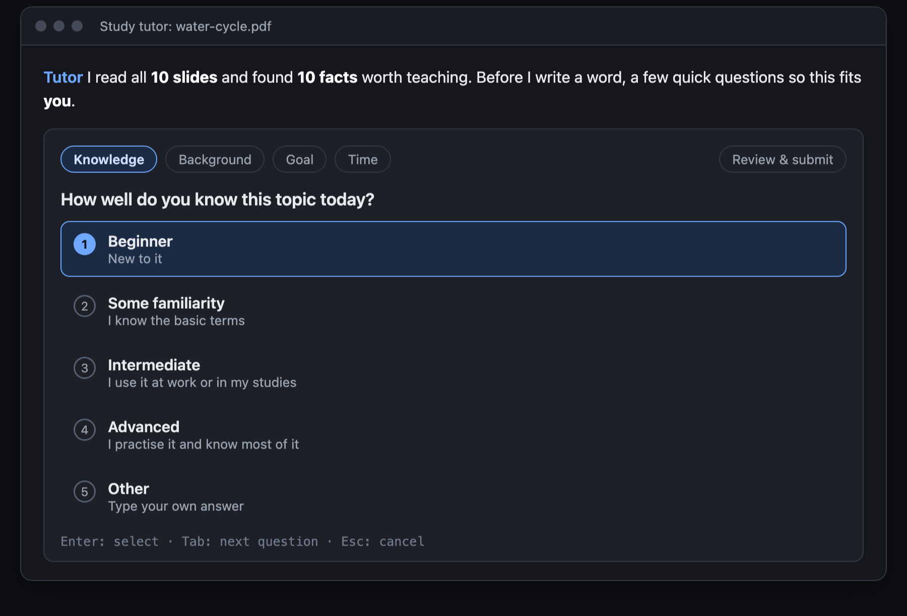
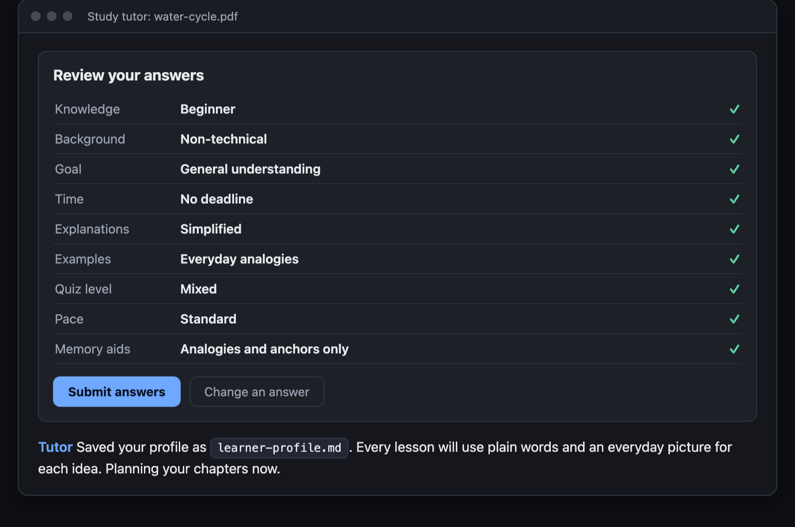
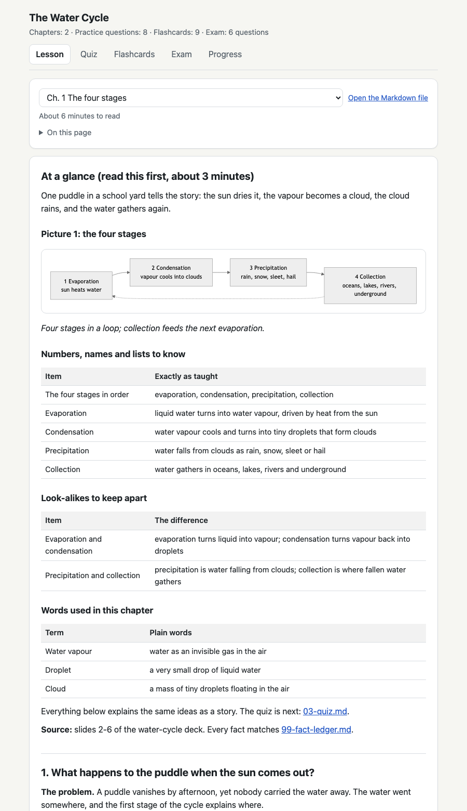
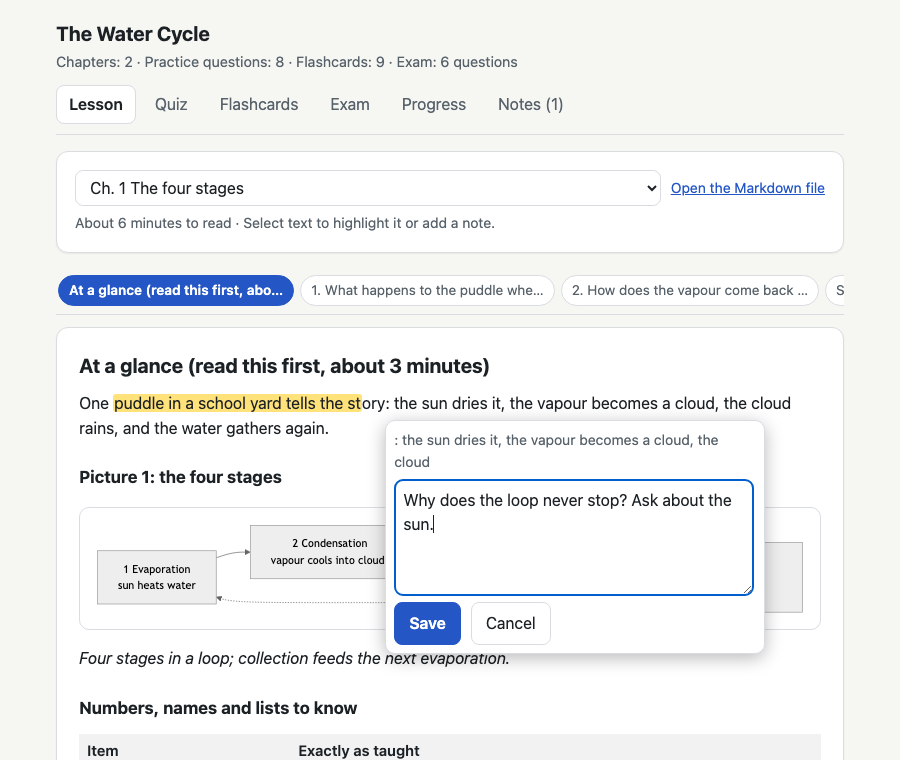

# study-guide-tutor-skill

**Hand your AI assistant a PDF, a slide deck or your notes. It teaches you what is in them, quizzes you until it sticks, and shows you exactly what to revisit.**


*The practice page the tutor builds for you (a real screenshot). Here: a 10-slide PDF about the water cycle.*

[](https://github.com/bassem-elsodany/study-guide-tutor-skill/actions/workflows/ci.yml) [](LICENSE) [](https://github.com/bassem-elsodany/study-guide-tutor-skill/releases)

## What you get

- **A tutor that asks about you first.** Your level, your goal, how much time you have. Everything it writes is written for you.
- **Lessons that teach.** Short and clear, with a "tricky part" warning wherever people usually get confused, not slides re-typed into bullet points.
- **One page for everything.** Read the lesson, take the quiz, flip the cards and sit the exam in a single file. Section tabs follow you down the page, so you can jump to any part. The lessons are still plain Markdown files you can open in any editor, whichever you prefer.
- **Highlight and take notes as you read.** Select any text to highlight it or write yourself a note. Everything you marked is listed by chapter, can be downloaded as a Markdown file, and goes to the tutor with your results, so it can see where you got stuck.
- **Practice that gives the reason.** Click an answer and see at once why each wrong option is wrong and which slide the fact came from.
- **Flashcards and a mock exam.** Cards come back just when you are about to forget them; a timed exam shows which chapters to go back to.
- **It works with what you have.** PDFs, PowerPoint, Word, notes, web pages, lecture transcripts, scanned pages; in any language; however your material is organised.

## See it in action: a 10-slide PDF about the water cycle

Say you have a short PDF about the water cycle. (A copy is in [`examples/water-cycle/`](examples/water-cycle/water-cycle.pdf), so you can follow along.) This is what happens, step by step. The tutor's wording below is illustrative; the questions, lesson text and practice page are real.

### 1. You hand it the file

```text
you    > Teach me this PDF.        [water-cycle.pdf]
```

### 2. It reads everything first, then asks about you

```text
tutor  > I read all 10 slides and found 10 facts worth teaching, one of them a number (97%).
         Before I write a word, a few quick questions so this fits you.
```



You pick one option for each question, four at a time: how much you know, your background, what you are studying for, how much time you have, how to explain things, which examples help you, how hard the quizzes should be, how big each step should be, and whether you want memory aids. Nothing to type. Then you see all nine answers before you confirm:



*Mock-ups of the screens (the questions and options are the real ones).* Your answers become a one-page profile that shapes every file. Pick *Beginner, Non-technical, Simplified, Everyday analogies* and every idea comes with plain words and a picture from daily life. Pick *Advanced, Concise, Exam-level* and the basics are skipped and the questions get harder. Change your mind any time: say **"too dense"** or **"too easy"** and the tutor rewrites the affected files.

### 3. It shows you the plan before it writes anything

```text
tutor  > Two chapters:
           1. The four stages           (slides 2-6)
           2. Where the water goes      (slides 7-10)
         Every fact keeps its slide number, so you can always find the source.
         Start with chapter 1?
```

If your material comes in modules, weeks or parts, the tutor mirrors that instead; a plain book or a single deck stays a simple list of chapters. You confirm the layout once.

### 4. Each chapter is a lesson written like a teacher would

A three-minute summary comes first, then the story, with a warning wherever people usually slip. This is real text from chapter 1:

> *Everyday picture:* a wet towel on a washing line. The towel dries because the water leaves it as vapour, and the line is not even hot.
>
> **⚠ Tricky part: evaporation or condensation?**
> Both involve water vapour, so they get swapped.
> **Hint:** ask which way the water is changing: from liquid up into vapour, or from vapour back into droplets.

Try the hint first. Then open the box for the rule and a memory hook. Each chapter ends with the traps people fall into.

Every lesson is a plain Markdown file, so you can read it in any editor or on GitHub. The practice page below shows the same lessons as its first tab, so you never have to leave it.

### 5. Then you practise

That is the page in the picture at the top: one file you open by double-clicking it, no install needed. It opens on the lesson, so reading, quizzing and flashcards live in one place.



| Tab | What it does |
|---|---|
| **Lesson** | the chapter you picked, as a page: the diagram, tables and warnings, a bar of section tabs that follows you down the page, an "I have read this chapter" box, and buttons to that chapter's quiz and flashcards. It is the same text as the Markdown file, which a link on the page opens. Select any text to **highlight** it or **add a note** (see below). |
| **Quiz** | click an answer; the right one turns green at once, and you see why every wrong option is wrong. Hints are optional and shown only when you ask. |
| **Flashcards** | flip, then "knew it" or "missed it". A card you miss comes back today; one you know comes back after 1, 3, 7, then 14 days. |
| **Exam** | a timed mock exam with no feedback until you finish, then a list of the chapters to revisit. |
| **Progress** | your scores, the questions you still miss, and a button to save your results. |
| **Notes** | every highlight and note you made, by chapter, with a button that jumps back to the spot in the lesson and one that downloads them all as a Markdown file. |



*Highlights and notes stay in your browser. Your notes are included in the results file you send the tutor, so it can see what confused you.*

### 6. Afterwards

Save your results and send the file to the tutor. It writes a short review of what you missed, adds those points to your revisit list, and plans when to come back to them.

**Want to see the real thing?** Open [`examples/water-cycle/course/`](examples/water-cycle/course/README.md): the whole course the tutor made from that PDF. Download `00-overview/09-study-player.html` and double-click it to try the practice page yourself.

## Install (two minutes)

In Claude Code:

```
/plugin marketplace add bassem-elsodany/study-guide-tutor-skill
/plugin install study-guide-tutor-skill@study-guide-tutor-skill
```

Then run `/reload-plugins`, put your PDF in a folder, and say **"Teach me this PDF."** (Or type `/study-guide-tutor-skill:study my-notes.pdf`.)

Using another AI tool, a team setup, or something not working? See [docs/installation.md](docs/installation.md). The same plugin is also available from the [bassem-elsodany-agent-skills](https://github.com/bassem-elsodany/bassem-elsodany-agent-skills) catalog, together with the Rust skills.

## Things you can say

| You say | What happens |
|---|---|
| "Teach me this PDF" | intake, plan, then lessons one chapter at a time |
| "Quiz me on chapter 2" | questions with instant reasons, saved results |
| "Make me the practice page" | the clickable page: quiz, flashcards, exam, progress |
| "I only have an hour before the exam" | a short recap of what matters, flashcards, one quiz on the weak spots |
| "Quiz me on what I missed" | fresh questions on your misses until they clear |
| "Check everything" | the tutor checks the course for mistakes and tells you what it found |

## What is in the bundle

One plugin installs everything below. Nothing runs in the background: no hooks, no services.

| Part | Name | What it does | How you use it |
|---|---|---|---|
| **Skill** | `study-guide-tutor-skill` | The tutor itself: asks about you, reads your material, writes the lessons, quizzes you, grades you and plans your revisits | starts by itself when you ask to study, learn, be quizzed or prepare for an exam |
| **Command** | `/study-guide-tutor-skill:study` | Start or continue a course from your material | `/study-guide-tutor-skill:study my-notes.pdf` |
| **Command** | `/study-guide-tutor-skill:study-quiz` | Quiz a chapter (or a whole unit), or grade the answers you give | `/study-guide-tutor-skill:study-quiz 2` |
| **Command** | `/study-guide-tutor-skill:study-player` | Build the clickable practice page: quiz, flashcards, exam, progress | `/study-guide-tutor-skill:study-player` |
| **Command** | `/study-guide-tutor-skill:study-cram` | Cram mode for a short deadline: a recap of what matters, flashcards, one quiz | `/study-guide-tutor-skill:study-cram 2 hours` |
| **Command** | `/study-guide-tutor-skill:study-weak` | Re-quiz what you keep missing, with fresh questions, until it clears | `/study-guide-tutor-skill:study-weak` |
| **Command** | `/study-guide-tutor-skill:study-check` | Check a finished course for mistakes and report what it found | `/study-guide-tutor-skill:study-check` |
| **Helper** | `teacher-writer` | Writes one chapter's lesson the way a teacher would, for your profile | used by the tutor behind the scenes |
| **Helper** | `student-reviewer` | Plays a learner to test whether a lesson is quick to learn from | used by the tutor behind the scenes |

That is 1 skill, 6 commands and 2 helpers. You never have to type a command: saying what you want in your own words works too (see the table above).

## Questions

**Does my material leave my computer?** The skill itself makes no network calls and keeps everything in your folder. Like any AI assistant, the text you give it is processed by the AI service you use, under that service's terms.

**Do I need to be technical?** You need an AI assistant that supports plugins, such as Claude Code, and two commands to paste. After that it is a conversation and a web page.

**Which files can it read?** PDF, PowerPoint (`.pptx`), Word (`.docx`), Markdown and plain text, web pages, e-books (`.epub`), subtitle and transcript files, images, or a folder of scanned pages. Spreadsheets, audio and video need a transcript first.

**My notes are not in English.** Fine. The tutor writes in your language. For a language other than English it also uses a small settings file for the wording; the sample course in `tests/fixtures/spanish-course` shows how, and Arabic, Hebrew, Persian and Urdu flip the page to right-to-left.

**Is it only for exams?** No. Pick "General understanding" or "Apply it at work" at the intake and the tutor adjusts what it asks of you.

**What does it cost?** The skill is free and open source. You pay for your AI assistant as usual.

## Good to know

- It has been built and tested on one real 43-chapter course and on small invented examples (including a Spanish one). It has not been tried on every kind of material.
- Word and PowerPoint files are read as text only: tables, charts and pictures inside them are not understood. A scanned page needs the tutor to look at it.
- The quizzes check facts that are in your material. They do not bring in outside knowledge, on purpose, because exams test the course's version.
- The checks behind the scenes are automatic but not perfect; a careful reader still beats them.

## For the curious

- [How it works](docs/how-it-works.md): the teaching loop, the checks that keep it honest, the folder layouts, the settings file.
- [Installation](docs/installation.md): every way to install, other AI tools, fixes for common problems.
- [Contributing](CONTRIBUTING.md) · [Changelog](CHANGELOG.md) · [Security](SECURITY.md)

## Licence

Apache License 2.0: see [LICENSE](LICENSE). You are free to use, change and share it. If you redistribute it or a modified version, keep the `LICENSE` and `NOTICE` files (they credit this repository) and say what you changed. Notes on optional tools and on the study material you add are in [NOTICE](NOTICE).
