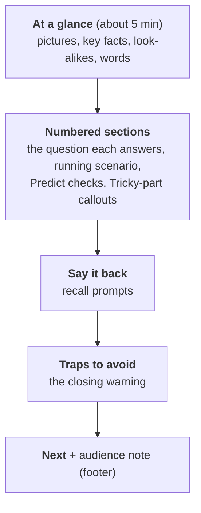
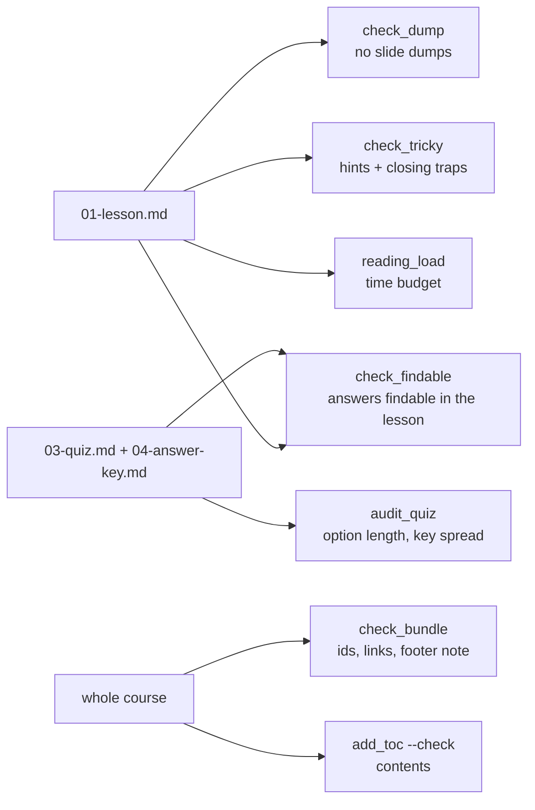

# How study-guide-tutor-skill works

The technical companion to the [README](../README.md): what the skill does at each step, the checks that keep its output honest, the folder layouts it produces, and how to develop and test it. For a first look, start with the README.

## Why this exists

Coding agents are fluent teachers and still make the same expensive mistakes with study material:

| What goes wrong | What study-guide-tutor-skill does about it |
|---|---|
| The agent starts explaining before it knows who it is teaching | **Intake first**: nine multiple-choice questions, saved as a profile; nothing is generated before it exists. Every file ends with a note saying whom it was written for |
| Lessons are the slides re-worded into lists and tables | `check_dump.py`: a section whose wording is mostly the source's, or that has no teaching element, fails. The teacher persona plans a running scenario, Predict checks and links between ideas |
| Quiz questions are answerable by picking the longest option | `audit_quiz.py`: options of equal length, the key longest in only 20 to 40% of questions, key letters spread, every wrong option explained |
| A question tests a fact the lesson never taught | `check_findable.py`: the correct answer's content must be findable in the lesson's at-a-glance block; Predict boxes may not copy quiz scenarios |
| Students fall for the same look-alikes | 2 to 4 inline **Tricky part** callouts per lesson (the confusion, a hint that is a test and not the answer, a collapsed rule and anchor) and a closing **Traps to avoid** table; `check_tricky.py` enforces both |
| Numbers drift and attributions fall off | a **fact ledger** with a source location per fact; every key traces to it; an independent fidelity review samples questions against the source |
| Long lessons nobody finishes | `reading_load.py`: a reading budget per chapter and per at-a-glance block |
| Misses are shrugged off | grading with a memory anchor per miss, `05-review.md`, a revisit list, fresh-variant retakes and a dated spaced-review plan |

## It adapts to what you give it

Nothing in the skill assumes slides, English or one folder layout. It looks at your material first and shapes the course to it.

| What you bring | What the skill does |
|---|---|
| **A file type** | reads **pdf, pptx, docx, md, txt, html, epub, srt, vtt**, a single image, or a folder of images (scanned notes, photographed slides) into a numbered text cache, one unit per slide, page, section or time segment. Spreadsheets, audio and video are not read directly: transcribe them first (a `.txt`, `.srt` or `.vtt` transcript works) |
| **Its own numbering** | cites facts in the source's unit: "slide 12", "page 4", "section 3", "minute 14" |
| **A flat sequence** (a book, one deck) | a flat course: `chapter-NN-slug/` folders and one overview at the course root |
| **A natural grouping** (modules, weeks, parts, volumes, domains) | one group folder per source group, named with the source's own word (`module-2`, `week-03`, `part-1`), each with its own overview and player |
| **Another language** | writes everything in the student's language; a `course.json` carries the language, the structural words the gates look for, and the player's text (Arabic, Hebrew, Persian and Urdu flip the player to right-to-left). Copy [`templates/course.json`](../templates/course.json) and translate it |
| **A learner** | the intake profile sets level, goal, time, style, quiz difficulty and the audience note of every file |

Chapter folders are found by their **content** (a lesson, quiz, ledger or flashcards), not by their name, so `chapter-03-x`, `lecture-3-x`, `week-2-x` and `capitulo-01-x` all work. The test suite proves each case with five differently structured courses (a flat course; modules; weeks with lecture folders; term/week/session nesting; a Spanish course grouped by unidad), an Arabic variant for right-to-left, and a reader test for every source type.

## How it thinks

The loop is in [`SKILL.md`](../skills/study-guide-tutor-skill/SKILL.md); the depth is in [`references/`](../skills/study-guide-tutor-skill/references). Three ideas drive everything:

1. **Facts never change with the level; the explanation does.** A beginner and an expert get the same exam facts, in different words, examples and order.
2. **Material-only by default.** What is taught and keyed traces to the source, because the exam tests the course's version. The agent's own analogies are labelled ("my analogy") and anything outside is marked "Outside the material".
3. **Teach, then warn.** The lesson explains why, makes the student predict, flags the look-alike where the mix-up happens, and closes with the traps.



*Anatomy of one lesson file. The top block alone must let the student pass the quiz; everything below it is the optional explanation.*

## What's inside

| | |
|---|---|
| **1 skill** | [`skills/study-guide-tutor-skill/SKILL.md`](../skills/study-guide-tutor-skill/SKILL.md): intake, ingest, structure, teach, quiz, grade, review, study modes |
| **12 reference files** | intake analysis, question design, source fidelity, teaching design, student review, fidelity review, grading files, learning science, memorization techniques, artifacts, lifecycle, banner texts |
| **2 agents** | `teacher-writer` (one chapter lesson, read-write), `student-reviewer` (plays the learner, read-only) |
| **6 commands** | `/study`, `/study-quiz`, `/study-player`, `/study-cram`, `/study-weak`, `/study-check` |
| **17 scripts** (and a shared layout helper) | extract the source once, build the at-a-glance block, number files, add contents and the audience note, build the exam, and the eight gates below; Python standard library only |
| **Templates** | a learner-profile template, the generated course layout, an overview-folder guide, and `course.json` (every label and player string, ready to translate) |
| **Examples and test courses** | [`examples/water-cycle/`](../examples/water-cycle/): a 10-slide PDF and the course made from it. [`tests/fixtures/`](../tests/fixtures/): the same two chapters in four more folder structures (by module, by week with lecture folders, nested term/week/session) and a Spanish course grouped by unidad. All invented, all passing every gate; used by CI |

### The gates

Each gate is a script that exits non-zero, so an agent cannot call a chapter done while it fails.

| Gate | Script | Fails when |
|---|---|---|
| Contents | `add_toc.py --check` | a generated markdown file has no table of contents |
| Quiz audit | `audit_quiz.py` | wrong option count, key and explanation mismatch, key letters clustered, the correct option is the longest too often or too much longer |
| Bundle | `check_bundle.py` | a missing file, a wrong chapter number, an unknown ledger ID, a broken link, a missing or doubled audience note |
| No dumps | `check_dump.py` | a section is mostly the source's wording, or has no Predict, analogy or link |
| Tricky parts | `check_tricky.py` | fewer than 2 or more than 4 callouts, a callout with no hint or rule, traps not closing the lesson |
| Findable | `check_findable.py` | a quiz answer is not in the lesson, or a Predict copies a quiz scenario |
| Reading load | `reading_load.py` | the glance block or the whole lesson exceeds the reading budget (a flag, not an error) |
| Source cache | `source_text.py check` | an original changed after it was extracted |



## The interactive player

`/study-guide-tutor-skill:study-player <unit folder>` (or `python3 skills/study-guide-tutor-skill/scripts/make_player.py <unit folder>`) turns the quiz, answer-key and flashcard files of a unit into **one HTML file** that opens by double-click: no install, no server, no network. Your progress is saved in the browser only.

| Mode | What you get |
|---|---|
| **Quiz** | click an option or press A to D; the right answer turns green at once; every wrong option comes with the reason it is wrong, the source location and the explanation; an optional hint (marked in your score); answer order is shuffled; "Retake the misses" |
| **Flashcards** | flip, then "knew it" or "missed it"; a missed card returns today, a known card waits 1, 3, 7, then 14 days (five boxes); due counts per deck |
| **Exam** | the timed exam: no feedback until you submit, free navigation, results by chapter with "revisit" flags, review of every miss |
| **Progress** | last and best score per chapter, flashcard boxes, the questions you still miss, exam attempts, and **Download my results (JSON)** to send back to the tutor |

The tutor turns a results file into `05-review.md` (graded misses with memory anchors), a score-tracker update and a revisit list. The player reads the same Markdown the gates check, so it cannot show a question that failed the audit. `scripts/test-player.sh` drives it in headless Chrome as a click-through test. Questions that refer to options by letter ("both A and B") are never reshuffled.

## The files it generates

The folder tree mirrors your material, and **the grouping level is optional**: the skill looks at the material, proposes a layout, and you confirm it once. Every file has a number that is its reading order.

**No higher level in the material** (a book, one deck, a single course): a flat course.

```
my-course/
├── learner-profile.md                 written after the intake
├── README.md                          start here: the player, the loop, the chapter table
├── 00-overview/                       README.md (what each file is for), concept map, cram sheet, final quiz, score tracker, revisit list, exam, 09-study-player.html
├── chapter-01-short-slug/
│   ├── 01-lesson.md                   at a glance, numbered sections, tricky parts, say it back, traps, next
│   ├── 02-flashcards.csv
│   ├── 03-quiz.md  ·  04-answer-key.md  ·  05-review.md (after grading)
│   └── 99-fact-ledger.md              every checkable fact with its source location
└── chapter-02-short-slug/ ...
```

**A natural higher level** (modules, weeks, parts, volumes, domains): one folder per group, named with the source's own word, each with its own `00-overview/`. Chapter numbers restart in each group.

```
my-course/
├── learner-profile.md
├── module-1/                          or week-01, part-1, domain-1 ... whatever the material calls it
│   ├── README.md
│   ├── 00-overview/                   one overview and one player per group
│   └── chapter-01-short-slug/ ...
└── module-2/ ...
```

The scripts need no configuration for either shape: a *unit* is any folder that directly holds `chapter-*/` folders, and every script finds units on its own. More in [`templates/course-layout.md`](../templates/course-layout.md).

## Configuration

Nothing is required: there are no hooks and no environment variables. What you can tune:

| Where | What |
|---|---|
| `learner-profile.md` (written by the intake; template in [`templates/`](../templates/learner-profile.md)) | level, background, goal, time, explanation style, examples, quiz level, pace, memory aids, and the one-line **Audience statement** used in every file's footer |
| Your prompts | "too simple", "too dense", "too easy", "too hard": the skill re-profiles and regenerates the affected files |
| `course.json` at the course root (template in [`templates/`](../templates/course.json)) | the course's language, the structural words the gates look for, the audience note's wording and every string of the player; all optional, English by default |
| Script flags | e.g. `audit_quiz.py --allow-easy`, `check_findable.py --min-glance 0.6`, `reading_load.py`: each script's `--help` lists them |

## Safety and privacy

- **No network.** The scripts make no network calls. `pdftotext` and `mmdc` run locally as separate programs, only if installed.
- **Your material stays on your machine.** Nothing is uploaded by the skill. A generated course can contain copyrighted lecture text in its fact ledger and cache: keep it private unless you may share it. This repository ships no course material; the sample course is invented.
- **Scripts write only inside the folder you give them** (plus a text cache beside the source for `source_text.py`). They never delete a study file.
- **No personal data in the repository**: `scripts/validate-plugin.py` fails on absolute paths, personal email addresses and machine names.
- Report vulnerabilities privately: [SECURITY.md](../SECURITY.md).

## Develop and verify

```bash
# in a clone
scripts/quality-check.sh && python3 -I scripts/validate-plugin.py --self-test && python3 -I scripts/validate-plugin.py .
claude plugin validate . --strict        # the official validator (needs the Claude Code CLI)
```

`quality-check.sh` compiles every script, runs each with `--help`, and runs the gates against the sample course. CI ([`.github/workflows/ci.yml`](../.github/workflows/ci.yml)) runs the same set plus the installer for other agents.

```
skills/study-guide-tutor-skill/SKILL.md   the decision guide      references/ scripts/   depth and gates, loaded on demand
agents/  commands/                   Claude Code agents and slash commands
scripts/                             repository checks and the installer for other agents
templates/  docs/  examples/         profile, layout and course.json templates; these docs and diagrams; a worked example (PDF in, course out)
tests/                               a sample course the gates run against
.claude-plugin/  .github/  .claude/  manifests, CI and templates, import of AGENTS.md
```

Contributing: [CONTRIBUTING.md](../CONTRIBUTING.md) (authoring standards, what a good report contains). Changes: [CHANGELOG.md](../CHANGELOG.md).

## Status and limits

- **Version 1.1.0**, single maintainer, opinionated by design.
- Built and refined on one real course (a professional-certification course of 43 chapters across four units, taught from lecture PDFs) and verified on the invented sample course. It has not yet been run on other kinds of material, such as video transcripts, books or code bootcamps.
- The gates are **heuristics**: `check_findable.py` and `check_dump.py` compare words, so a paraphrase can false-alarm and a clever dump could pass. They nominate; a reader decides. The `student-reviewer` and fidelity-review prompts exist for that.
- The scripts assume lecture-style material (a source with numbered units, cited in ledgers) and chapter folders that hold the skill's numbered files; folder names and grouping are free, and ledger IDs are `<letters><chapter number>-NNN`, unique within a unit.
- Tested languages: English, plus an invented Spanish course (labels, exam text, footer note and player text) and an Arabic setting for right-to-left direction. Other languages should work through `course.json` but have not been run. The reading-time budget assumes 200 words a minute, which is not right for every language (`reading_load.py --wpm`).
- Source readers use only the standard library: Word and PowerPoint files are read as text (headings, paragraphs, slide text, speaker notes), not as images, tables or charts, and a PDF needs `pdftotext` or `pypdf`. Scanned or image-only material is marked for a visual read, which the agent does by looking at it.
- Adding the tricky-part callouts lengthens lessons by about a minute; `reading_load.py` reports the cost against the budget.
- Verified: the repository checks, the installer, the gates on the sample course, and the interactive player in headless Chrome (scripted click-through, plus manual screenshots at phone and desktop width). Not verified: the player in Safari, Firefox or Edge, or with a screen reader. Not verified: other agents, Windows, other source formats, Claude Code versions beyond those in use when it was written.
