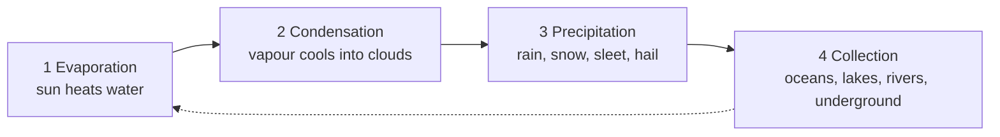

# Lecture 1: The four stages

<!-- toc -->
## Contents

- [At a glance (read this first, about 3 minutes)](#at-a-glance-read-this-first-about-3-minutes)
  - [Picture 1: the four stages](#picture-1-the-four-stages)
  - [Numbers, names and lists to know](#numbers-names-and-lists-to-know)
  - [Look-alikes to keep apart](#look-alikes-to-keep-apart)
  - [Words used in this chapter](#words-used-in-this-chapter)
- [1. What happens to the puddle when the sun comes out?](#1-what-happens-to-the-puddle-when-the-sun-comes-out)
- [2. How does the vapour come back down?](#2-how-does-the-vapour-come-back-down)
- [Say it back (no peeking)](#say-it-back-no-peeking)
- [Traps to avoid](#traps-to-avoid)
- [Next](#next)
<!-- /toc -->

<!-- glance -->
<!-- authored -->
## At a glance (read this first, about 3 minutes)

One puddle in a school yard tells the story: the sun dries it, the vapour becomes a cloud, the cloud rains, and the water gathers again.

### Picture 1: the four stages

*Four stages in a loop; collection feeds the next evaporation.*

### Numbers, names and lists to know

| Item | Exactly as taught |
|---|---|
| The four stages in order | evaporation, condensation, precipitation, collection |
| Evaporation | liquid water turns into water vapour, driven by heat from the sun |
| Condensation | water vapour cools and turns into tiny droplets that form clouds |
| Precipitation | water falls from clouds as rain, snow, sleet or hail |
| Collection | water gathers in oceans, lakes, rivers and underground |

### Look-alikes to keep apart

| Item | The difference |
|---|---|
| Evaporation and condensation | evaporation turns liquid into vapour; condensation turns vapour back into droplets |
| Precipitation and collection | precipitation is water falling from clouds; collection is where fallen water gathers |

### Words used in this chapter

| Term | Plain words |
|---|---|
| Water vapour | water as an invisible gas in the air |
| Droplet | a very small drop of liquid water |
| Cloud | a mass of tiny droplets floating in the air |

Everything below explains the same ideas as a story. The quiz is next: [03-quiz.md](03-quiz.md).
<!-- /glance -->

**Source:** slides 2-6 of the water-cycle deck. Every fact matches [99-fact-ledger.md](99-fact-ledger.md).

## 1. What happens to the puddle when the sun comes out?

**The problem.** A puddle vanishes by afternoon, yet nobody carried the water away. The water went somewhere, and the first stage of the cycle explains where.

Heat from the sun makes the surface molecules of liquid water move fast enough to leave as vapour. That is evaporation, and it needs no boiling: a puddle in warm air does it all day. Once the vapour is up in the air it rises, and that sets up the second stage.

*Everyday picture (my analogy):* a wet towel on a washing line. The towel dries because the water leaves it as vapour, and the line is not even hot.

> **⚠ Tricky part: evaporation or condensation?**
> Both involve water vapour, so they get swapped.
> **Hint:** ask which way the water is changing: from liquid up into vapour, or from vapour back into droplets.

Rule and anchor

**Rule:** evaporation turns liquid water into vapour using the sun's heat; condensation turns vapour back into tiny droplets.
**Anchor:** (my anchor) evaporation goes up, condensation comes back.

<b>Predict:</b> a wet road dries in an hour on a sunny afternoon. Which stage removed the water from the road?

Evaporation: the sun's heat turned the liquid into vapour.

**Next question: what does the vapour do once it is up there?**

## 2. How does the vapour come back down?

**The problem.** The air cannot hold unlimited vapour, and the vapour does not stay up forever. Three stages bring the water back toward the ground.

As the vapour rises it meets colder air and cools. Cooled vapour turns into tiny droplets, and enough droplets together make a cloud: this is condensation. When droplets grow heavy they fall as rain, snow, sleet or hail, which is precipitation. The water then gathers in oceans, lakes, rivers and underground, and that last stage is collection, where the loop closes.

*Everyday picture (my analogy):* a cold glass on a summer table gets beaded with water. The glass did not leak; the air around it cooled and shed some of its vapour.

> **⚠ Tricky part: precipitation or collection?**
> Both are about water arriving, so they get swapped.
> **Hint:** ask whether the water is still on its way down or has already gathered somewhere.

Rule and anchor

**Rule:** precipitation is water falling from clouds as rain, snow, sleet or hail; collection is water gathering in oceans, lakes, rivers and underground.
**Anchor:** (my anchor) falling versus gathering.

<b>Predict:</b> on a winter night a window pane is covered with fine droplets on the inside. Which stage is happening there?

Condensation: warm indoor vapour met the cold glass and turned back into liquid.

## Say it back (no peeking)

1. Put the four stages in order and say what drives the first one.

Evaporation, condensation, precipitation, collection; the first is driven by heat from the sun.

2. What separates precipitation from collection?

Precipitation is the water falling out of the cloud; collection is where it ends up.

<!-- traps -->
## Traps to avoid

The last warning before the quiz. Each row is a mix-up the exam is built on; the "Tricky part" boxes in the sections above show how to tell each pair apart.

| Trap | Why it fools people |
|---|---|
| Evaporation and condensation are the same | Both involve vapour; one makes it, the other turns it back into droplets |
| Precipitation and collection are the same | Both are about water arriving; one is falling, the other is gathered |
| The cycle stops at collection | Collection feeds the next evaporation, so the loop closes |
<!-- /traps -->

## Next

Next: [03-quiz.md](03-quiz.md) (test yourself) · [02-flashcards.csv](02-flashcards.csv)

---

<!-- audience-banner:end -->
> **Audience:** written for a beginner to the topic with no technical background, studying for general understanding with no deadline. Adapted to the learner profile. Pictures and tables first, definitions in the words the profile asks for, an example per idea. Left out: only what the goal does not test; the fact ledger keeps every fact. Facts never change with the level, only the wording, examples, order and difficulty. Wrong level ("too simple", "too dense", "too easy", "too hard")? Tell me and I will regenerate. Profile: [`learner-profile.md`](../../learner-profile.md), version 1.
<!-- /audience-banner -->
