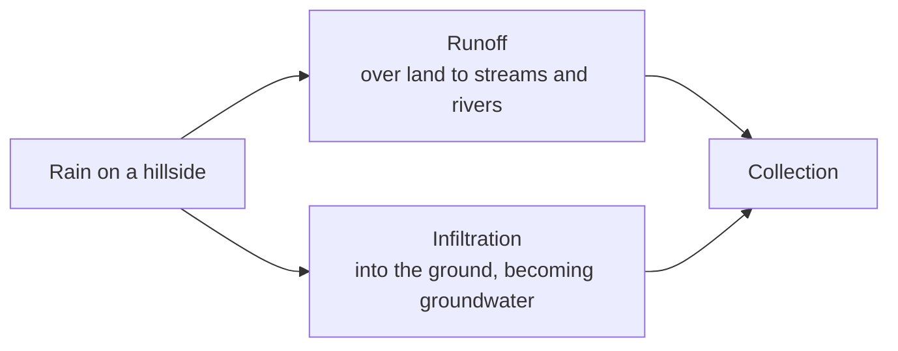

# Session 1: Where the water goes

<!-- toc -->
## Contents

- [At a glance (read this first, about 3 minutes)](#at-a-glance-read-this-first-about-3-minutes)
  - [Picture 1: where does fallen water go?](#picture-1-where-does-fallen-water-go)
  - [Numbers, names and lists to know](#numbers-names-and-lists-to-know)
  - [Look-alikes to keep apart](#look-alikes-to-keep-apart)
  - [Words used in this chapter](#words-used-in-this-chapter)
- [1. How do plants join in?](#1-how-do-plants-join-in)
- [2. Where does the fallen water travel?](#2-where-does-the-fallen-water-travel)
- [Say it back (no peeking)](#say-it-back-no-peeking)
- [Traps to avoid](#traps-to-avoid)
- [Next](#next)
<!-- /toc -->

<!-- glance -->
<!-- authored -->
## At a glance (read this first, about 3 minutes)

The puddle story continues: plants add vapour of their own, the rain that falls takes different paths, and ice can skip a step.

### Picture 1: where does fallen water go?

*Two paths from the same rain, both leading toward collection.*

### Numbers, names and lists to know

| Item | Exactly as taught |
|---|---|
| Transpiration | plants release water vapour through their leaves; with evaporation it is called evapotranspiration |
| Share of Earth's water that is salt water in the oceans | about 97% |
| Runoff | water flowing over land into streams and rivers |
| Infiltration | water soaking into the ground and becoming groundwater |
| Sublimation | ice turns directly into vapour without becoming liquid first |

### Look-alikes to keep apart

| Item | The difference |
|---|---|
| Evaporation and transpiration | evaporation comes off water; transpiration comes out of plant leaves |
| Runoff and infiltration | runoff flows over land into streams and rivers; infiltration soaks into the ground and becomes groundwater |

### Words used in this chapter

| Term | Plain words |
|---|---|
| Groundwater | water held in the soil and rock below the surface |
| Evapotranspiration | the two ways water reaches the air from the land, taken together |
| Salt water | water with salt dissolved in it, as in the oceans |

Everything below explains the same ideas as a story. The quiz is next: [03-quiz.md](03-quiz.md).
<!-- /glance -->

**Source:** slides 7-10 of the water-cycle deck. Every fact matches [99-fact-ledger.md](99-fact-ledger.md).

## 1. How do plants join in?

**The problem.** Puddles are not the only source of vapour. Land covered with plants gives off water too, and the lecture gives that its own name.

The plants growing around the puddle add to the vapour, because their leaves release water into the air as well. The lecture calls that transpiration. Evaporation from surfaces and transpiration from plants together are called evapotranspiration, the two ways water reaches the air from the land.

*Everyday picture (my analogy):* a field of grass on a warm day is like a crowd of tiny breathing mouths, each one letting a little water out.

> **⚠ Tricky part: evaporation or transpiration?**
> Both put water vapour into the air, so the words get swapped.
> **Hint:** ask whether the vapour came off a body of water or out of a plant.

Rule and anchor

**Rule:** evaporation turns liquid water into vapour using the sun's heat; transpiration is plants releasing vapour through their leaves; the two together are evapotranspiration.
**Anchor:** (my anchor) the puddle breathes out, and so do the leaves beside it.

<b>Predict:</b> a greenhouse is sealed, yet its glass fogs up after a sunny morning in a room full of tomato plants. Which source supplied most of the vapour?

The plants, through transpiration: the leaves released the vapour, and the glass cooled it.

**Next question: once the water has fallen, which way does it travel?**

## 2. Where does the fallen water travel?

**The problem.** Rain lands on one hillside and ends up in a river, in the soil and in the sea. Three ideas sort out the paths.

Water that flows over land and into streams and rivers is runoff. Water that soaks into the ground and becomes groundwater is infiltration. Either path leads toward collection. The oceans are where most of it finally sits: about 97% of Earth's water is salt water in the oceans. In very cold, dry places ice can skip the liquid step completely and turn directly into vapour, which is sublimation.

> **⚠ Tricky part: runoff or infiltration?**
> Both describe rain water leaving the surface, so they blur together.
> **Hint:** ask whether the water stays on top of the ground or goes down into it.

Rule and anchor

**Rule:** runoff flows over land into streams and rivers; infiltration soaks into the ground and becomes groundwater.
**Anchor:** (my anchor) runoff runs, infiltration sinks in.

<b>Predict:</b> a paved car park floods while a nearby lawn stays dry after the same storm. Which path did the lawn's water take?

Infiltration: the soil let the water soak in, while the pavement forced it to run off.

## Say it back (no peeking)

1. Why can a plant make a window fog up?

Transpiration releases vapour through leaves, and cool glass turns it back into liquid.

2. How do runoff and infiltration differ?

Runoff flows over land into streams and rivers; infiltration soaks into the ground as groundwater.

<!-- traps -->
## Traps to avoid

The last warning before the quiz. Each row is a mix-up the exam is built on; the "Tricky part" boxes in the sections above show how to tell each pair apart.

| Trap | Why it fools people |
|---|---|
| Evaporation and transpiration are the same | Both put vapour in the air; one comes off water, the other out of leaves |
| Runoff and infiltration are the same | Both move rain water; one stays on top, the other goes into the ground |
| Ice must melt before it becomes vapour | Sublimation skips the liquid step completely |
| Most of Earth's water is fresh | About 97% is salt water in the oceans |
<!-- /traps -->

## Next

Next: [03-quiz.md](03-quiz.md) (test yourself) · [02-flashcards.csv](02-flashcards.csv)

---

<!-- audience-banner:end -->
> **Audience:** written for a beginner to the topic with no technical background, studying for general understanding with no deadline. Adapted to the learner profile. Pictures and tables first, definitions in the words the profile asks for, an example per idea. Left out: only what the goal does not test; the fact ledger keeps every fact. Facts never change with the level, only the wording, examples, order and difficulty. Wrong level ("too simple", "too dense", "too easy", "too hard")? Tell me and I will regenerate. Profile: [`learner-profile.md`](../../../learner-profile.md), version 1.
<!-- /audience-banner -->
