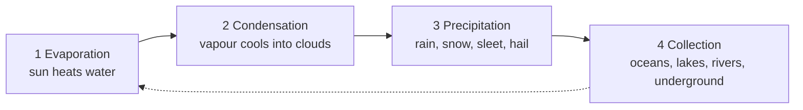

# Chapter 1: The Water Cycle

<!-- toc -->
## Contents

- [At a glance (read this first, about 3 minutes)](#at-a-glance-read-this-first-about-3-minutes)
  - [Picture 1: where does the puddle's water go?](#picture-1-where-does-the-puddles-water-go)
  - [Numbers, names and lists to know](#numbers-names-and-lists-to-know)
  - [Look-alikes to keep apart](#look-alikes-to-keep-apart)
  - [Words used in this chapter](#words-used-in-this-chapter)
- [1. What happens to the puddle when the sun comes out?](#1-what-happens-to-the-puddle-when-the-sun-comes-out)
- [2. How does the vapour come back down?](#2-how-does-the-vapour-come-back-down)
- [3. Where does the fallen water travel?](#3-where-does-the-fallen-water-travel)
- [Say it back (no peeking)](#say-it-back-no-peeking)
- [Traps to avoid](#traps-to-avoid)
- [Next](#next)
<!-- /toc -->

<!-- glance -->
<!-- authored -->
## At a glance (read this first, about 3 minutes)

One puddle in a school yard tells the whole story: the sun dries it, the vapour becomes a cloud, the cloud rains, and the rain finds its way back to the ground.

### Picture 1: where does the puddle's water go?

*Four stages in a loop; collection feeds the next evaporation.*

### Numbers, names and lists to know

| Item | Exactly as taught |
|---|---|
| The four stages in order | evaporation, condensation, precipitation, collection |
| Where collection happens | oceans, lakes, rivers and underground |
| Forms of precipitation | rain, snow, sleet or hail |
| Share of Earth's water that is salt water in the oceans | about 97% |

### Look-alikes to keep apart

| Item | The difference |
|---|---|
| Transpiration | plants release water vapour through their leaves; with evaporation it is called evapotranspiration |
| Runoff and infiltration | runoff flows over land into streams and rivers; infiltration soaks into the ground and becomes groundwater |
| Sublimation | ice turns directly into vapour without becoming liquid first |

### Words used in this chapter

| Term | Plain words |
|---|---|
| Water vapour | water as an invisible gas in the air |
| Droplet | a very small drop of liquid water |
| Groundwater | water held in the soil and rock below the surface |
| Evapotranspiration | the two ways water reaches the air from the land, taken together |

Everything below explains the same ideas as a story. The quiz is next: [03-quiz.md](03-quiz.md).
<!-- /glance -->

**Source:** slides 2-10 of an invented sample deck. Every fact matches [99-fact-ledger.md](99-fact-ledger.md).

## 1. What happens to the puddle when the sun comes out?

**The problem.** A puddle vanishes by afternoon, yet nobody carried the water away. The water went somewhere, and the first stage of the cycle explains where.

Heat from the sun makes the surface molecules of liquid water move fast enough to leave as vapour. That is evaporation, and it needs no boiling: a puddle in warm air does it all day. The plants growing around the puddle add to the vapour, because their leaves release water into the air as well. Together the two sources are called evapotranspiration.

*Everyday picture (my analogy):* a wet towel on a washing line. The towel dries because the water leaves it as vapour, and the line is not even hot.

> **⚠ Tricky part: evaporation or transpiration?**
> Both put water vapour into the air, so the words get swapped.
> **Hint:** ask whether the vapour came off a body of water or out of a plant.

Rule and anchor

**Rule:** evaporation turns liquid water into vapour using the sun's heat; transpiration is plants releasing vapour through their leaves; the two together are evapotranspiration.
**Anchor:** (my anchor) the puddle breathes out, and so do the leaves beside it.

<b>Predict:</b> a greenhouse is sealed, yet its glass fogs up after a sunny morning in a room full of tomato plants. Which source supplied most of the vapour?

The plants, through transpiration: the leaves released the vapour, and the glass cooled it.

**Next question: what does the vapour do once it is up there?**

## 2. How does the vapour come back down?

**The problem.** The air cannot hold unlimited vapour, and the vapour does not stay up forever. Two stages bring it back toward the ground.

As the vapour rises it meets colder air and cools. Cooled vapour turns into tiny droplets, and enough droplets together make a cloud: this is condensation. When droplets grow heavy they fall as rain, snow, sleet or hail, which is precipitation. The water then gathers in oceans, lakes, rivers and underground, and that last stage is collection, where the loop closes.

*Everyday picture (my analogy):* a cold glass on a summer table gets beaded with water. The glass did not leak; the air around it cooled and shed some of its vapour.

<b>Predict:</b> on a winter night a window pane is covered with fine droplets on the inside. Which stage is happening there?

Condensation: warm indoor vapour met the cold glass and turned back into liquid.

**Next question: once the water has fallen, which way does it travel?**

## 3. Where does the fallen water travel?

**The problem.** Rain lands on one hillside and ends up in a river, in the soil and in the sea. Three ideas sort out the paths.

Water that flows over land and into streams and rivers is runoff. Water that soaks into the ground and becomes groundwater is infiltration. Either path leads toward collection. The oceans are where most of it finally sits: about 97% of Earth's water is salt water in the oceans. In very cold, dry places ice can skip the liquid step completely and turn directly into vapour, which is sublimation.

> **⚠ Tricky part: runoff or infiltration?**
> Both describe rain water leaving the surface, so they blur together.
> **Hint:** ask whether the water stays on top of the ground or goes down into it.

Rule and anchor

**Rule:** runoff flows over land into streams and rivers; infiltration soaks into the ground and becomes groundwater.
**Anchor:** (my anchor) runoff runs, infiltration sinks in.

<b>Predict:</b> a paved car park floods while a nearby lawn stays dry after the same storm. Which path did the lawn's water take?

Infiltration: the soil let the water soak in, while the pavement forced it to run off.

## Say it back (no peeking)

1. Put the four stages in order and say what drives the first one.

Evaporation, condensation, precipitation, collection; the first is driven by heat from the sun.

2. Why can a plant make a window fog up?

Transpiration releases vapour through leaves, and cool glass turns it back into liquid.

<!-- traps -->
## Traps to avoid

The last warning before the quiz. Each row is a mix-up the exam is built on; the "Tricky part" boxes in the sections above show how to tell each pair apart.

| Trap | Why it fools people |
|---|---|
| Evaporation and transpiration are the same | Both put vapour in the air; one comes off water, the other out of leaves |
| Runoff and infiltration are the same | Both move rain water; one stays on top, the other goes into the ground |
| Ice must melt before it becomes vapour | Sublimation skips the liquid step completely |
| Most of Earth's water is fresh | About 97% is salt water in the oceans |
<!-- /traps -->

## Next

Next: [03-quiz.md](03-quiz.md) (test yourself) · [02-flashcards.csv](02-flashcards.csv)

---

<!-- audience-banner:end -->
> **Audience:** written for a beginner to the topic with no technical background, studying for general understanding with no deadline. Adapted to the learner profile. Pictures and tables first, definitions in the words the profile asks for, an example per idea. Left out: only what the goal does not test; the fact ledger keeps every fact. Facts never change with the level, only the wording, examples, order and difficulty. Wrong level ("too simple", "too dense", "too easy", "too hard")? Tell me and I will regenerate. Profile: [`learner-profile.md`](../../learner-profile.md), version 1.
<!-- /audience-banner -->
