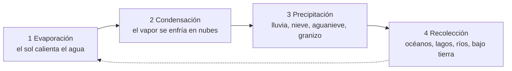

# Capítulo 1: El ciclo del agua

<!-- toc -->
## Contenido

- [De un vistazo (lee esto primero, unos 3 minutos)](#de-un-vistazo-lee-esto-primero-unos-3-minutos)
  - [Imagen 1: ¿adónde va el agua del charco?](#imagen-1-adónde-va-el-agua-del-charco)
  - [Números, nombres y listas que conviene saber](#números-nombres-y-listas-que-conviene-saber)
  - [Parecidos que no hay que confundir](#parecidos-que-no-hay-que-confundir)
  - [Palabras usadas en este capítulo](#palabras-usadas-en-este-capítulo)
- [1. ¿Qué le pasa al charco cuando sale el sol?](#1-qué-le-pasa-al-charco-cuando-sale-el-sol)
- [2. ¿Cómo vuelve a bajar el vapor?](#2-cómo-vuelve-a-bajar-el-vapor)
- [3. ¿Por dónde viaja el agua que ha caído?](#3-por-dónde-viaja-el-agua-que-ha-caído)
- [Dilo con tus palabras](#dilo-con-tus-palabras)
- [Trampas que evitar](#trampas-que-evitar)
- [Siguiente](#siguiente)
<!-- /toc -->

<!-- glance -->
<!-- authored -->
## De un vistazo (lee esto primero, unos 3 minutos)

Un solo charco en el patio de una escuela cuenta toda la historia: el sol lo seca, el vapor forma una nube, la nube llueve y la lluvia vuelve al suelo.

### Imagen 1: ¿adónde va el agua del charco?

*Cuatro etapas en círculo; la recolección alimenta la siguiente evaporación.*

### Números, nombres y listas que conviene saber

| Elemento | Tal como se enseña |
|---|---|
| Las cuatro etapas en orden | evaporación, condensación, precipitación, recolección |
| Dónde ocurre la recolección | océanos, lagos, ríos y bajo tierra |
| Formas de precipitación | lluvia, nieve, aguanieve o granizo |
| Parte del agua de la Tierra que es agua salada de los océanos | cerca del 97% |

### Parecidos que no hay que confundir

| Elemento | La diferencia |
|---|---|
| Transpiración | las plantas liberan vapor de agua por las hojas; con la evaporación se llama evapotranspiración |
| Escorrentía e infiltración | la escorrentía fluye sobre la tierra hacia arroyos y ríos; la infiltración se filtra en el suelo y pasa a ser agua subterránea |
| Sublimación | el hielo pasa directamente a vapor sin volverse líquido antes |

### Palabras usadas en este capítulo

| Término | En palabras sencillas |
|---|---|
| Vapor de agua | agua convertida en un gas invisible del aire |
| Gotita | una gota muy pequeña de agua líquida |
| Agua subterránea | agua guardada en el suelo y la roca bajo la superficie |
| Evapotranspiración | las dos formas en que el agua pasa del terreno al aire, vistas juntas |

Todo lo que sigue explica las mismas ideas como una historia. El cuestionario va después: [03-quiz.md](03-quiz.md).
<!-- /glance -->

**Fuente:** diapositivas 2-10 de una presentación de ejemplo inventada. Cada dato coincide con [99-fact-ledger.md](99-fact-ledger.md).

## 1. ¿Qué le pasa al charco cuando sale el sol?

**El problema.** Un charco desaparece a media tarde y nadie se llevó el agua. El agua fue a alguna parte, y la primera etapa del ciclo explica adónde.

El calor del sol hace que las moléculas de la superficie del agua se muevan tan deprisa que escapan como vapor. Eso es la evaporación, y no necesita hervir: un charco en aire templado la hace durante todo el día. Las plantas que crecen alrededor del charco añaden más vapor, porque sus hojas también sueltan agua al aire. Las dos fuentes juntas se llaman evapotranspiración.

*Imagen cotidiana (mi analogía):* una toalla mojada en el tendedero. La toalla se seca porque el agua sale en forma de vapor, y el tendedero ni siquiera está caliente.

> **⚠ Parte difícil: ¿evaporación o transpiración?**
> Las dos ponen vapor de agua en el aire, y por eso las palabras se confunden.
> **Pista:** pregúntate si el vapor salió de una masa de agua o de una planta.

Regla y ancla

**Regla:** la evaporación convierte agua líquida en vapor con el calor del sol; la transpiración es la liberación de vapor por las hojas de las plantas; juntas son la evapotranspiración.
**Ancla:** (mi ancla) el charco respira, y las hojas de al lado también.

<b>Predice:</b> un invernadero cerrado tiene el cristal empañado tras una mañana de sol en una sala llena de tomateras. ¿Qué fuente aportó casi todo el vapor?

Las plantas, por transpiración: las hojas soltaron el vapor y el cristal lo enfrió.

**Siguiente pregunta: ¿qué hace el vapor cuando ya está arriba?**

## 2. ¿Cómo vuelve a bajar el vapor?

**El problema.** El aire no puede guardar vapor sin límite, y el vapor no se queda arriba para siempre. Dos etapas lo devuelven hacia el suelo.

Al subir, el vapor encuentra aire más frío y se enfría. El vapor enfriado se convierte en gotitas diminutas, y muchas gotitas juntas forman una nube: es la condensación. Cuando las gotitas pesan demasiado caen como lluvia, nieve, aguanieve o granizo, que es la precipitación. Después el agua se reúne en océanos, lagos, ríos y bajo tierra, y esa última etapa es la recolección, donde el círculo se cierra.

*Imagen cotidiana (mi analogía):* un vaso frío en una mesa de verano se cubre de gotas. El vaso no tiene fugas; el aire que lo rodea se enfrió y soltó parte de su vapor.

<b>Predice:</b> en una noche de invierno la ventana se cubre por dentro de gotas finas. ¿Qué etapa ocurre ahí?

Condensación: el vapor cálido del interior tocó el cristal frío y volvió a ser líquido.

**Siguiente pregunta: una vez caída, ¿por dónde viaja el agua?**

## 3. ¿Por dónde viaja el agua que ha caído?

**El problema.** La lluvia cae en una ladera y acaba en un río, en el suelo y en el mar. Tres ideas ordenan los caminos.

El agua que fluye sobre la tierra hacia arroyos y ríos es escorrentía. El agua que se filtra en el suelo y pasa a ser agua subterránea es infiltración. Ambos caminos llevan hacia la recolección. Los océanos son donde casi toda termina: cerca del 97% del agua de la Tierra es agua salada de los océanos. En lugares muy fríos y secos el hielo puede saltarse el paso líquido y pasar directamente a vapor, y eso es la sublimación.

> **⚠ Parte difícil: ¿escorrentía o infiltración?**
> Las dos describen agua de lluvia que deja la superficie, y por eso se mezclan.
> **Pista:** pregúntate si el agua se queda encima del suelo o entra en él.

Regla y ancla

**Regla:** la escorrentía fluye sobre la tierra hacia arroyos y ríos; la infiltración se filtra en el suelo y pasa a ser agua subterránea.
**Ancla:** (mi ancla) la escorrentía corre, la infiltración se hunde.

<b>Predice:</b> un aparcamiento asfaltado se inunda mientras el césped de al lado sigue seco tras la misma tormenta. ¿Qué camino siguió el agua del césped?

La infiltración: el suelo dejó que el agua entrara, mientras el asfalto la obligó a correr.

## Dilo con tus palabras

1. Ordena las cuatro etapas y di qué impulsa la primera.

Evaporación, condensación, precipitación, recolección; la primera la impulsa el calor del sol.

2. ¿Por qué una planta puede empañar una ventana?

La transpiración libera vapor por las hojas, y el cristal frío lo vuelve líquido.

<!-- traps -->
## Trampas que evitar

La última advertencia antes del cuestionario. Cada fila es una confusión en la que se basa el examen; los cuadros «Parte difícil» de las secciones anteriores muestran cómo distinguir cada pareja.

| Trampa | Por qué engaña |
|---|---|
| Evaporación y transpiración son lo mismo | Las dos ponen vapor en el aire; una sale del agua y la otra de las hojas |
| Escorrentía e infiltración son lo mismo | Las dos mueven agua de lluvia; una se queda encima y la otra entra en el suelo |
| El hielo debe derretirse antes de ser vapor | La sublimación se salta por completo el paso líquido |
| La mayor parte del agua de la Tierra es dulce | Cerca del 97% es agua salada de los océanos |
<!-- /traps -->

## Siguiente

Siguiente: [03-quiz.md](03-quiz.md) (ponte a prueba) · [02-flashcards.csv](02-flashcards.csv)

---

<!-- audience-banner:end -->
> **Audiencia:** escrito para una persona principiante sin formación técnica que estudia por comprensión general y sin fecha límite. Adaptado al perfil del estudiante. Imágenes y tablas primero, definiciones en palabras sencillas y un ejemplo por idea. Omitido: solo lo que el objetivo no evalúa; el registro de hechos conserva todo. Los hechos nunca cambian con el nivel, solo la redacción, los ejemplos, el orden y la dificultad. ¿Nivel equivocado («demasiado simple», «demasiado denso», «demasiado fácil», «demasiado difícil»)? Dímelo y lo regenero. Perfil: [`learner-profile.md`](../learner-profile.md), versión 1.
<!-- /audience-banner -->
